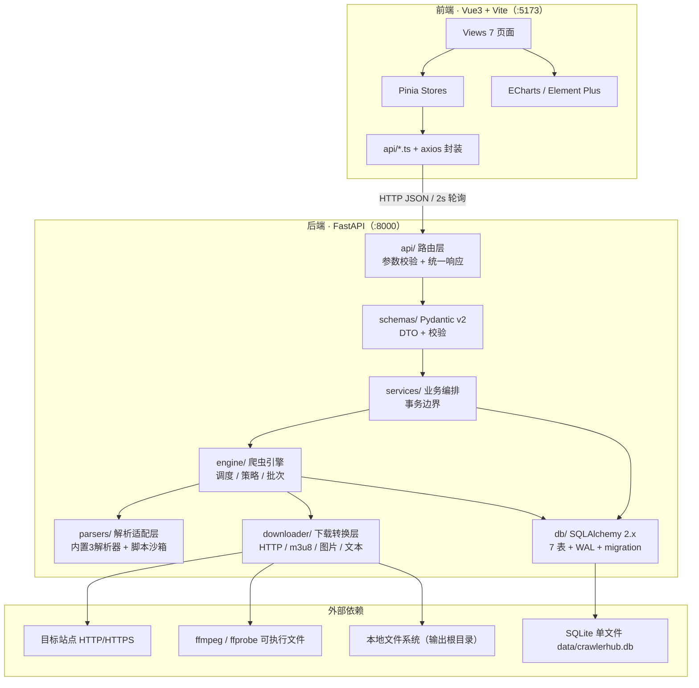
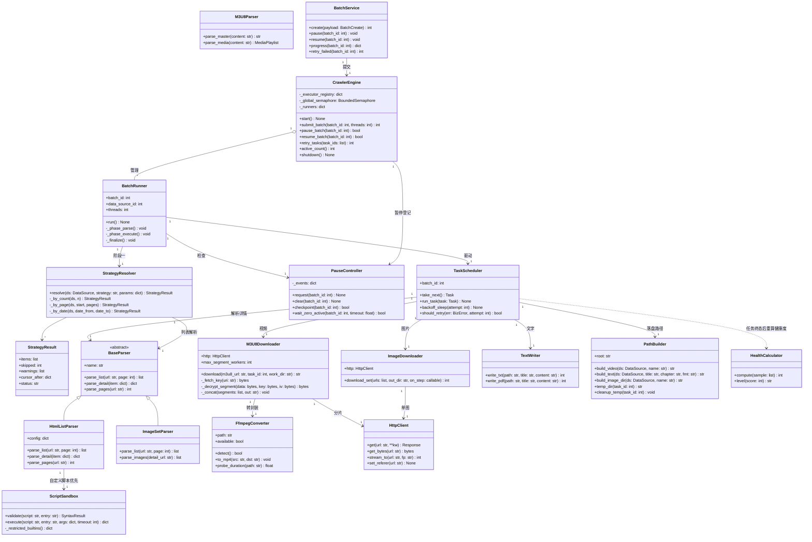
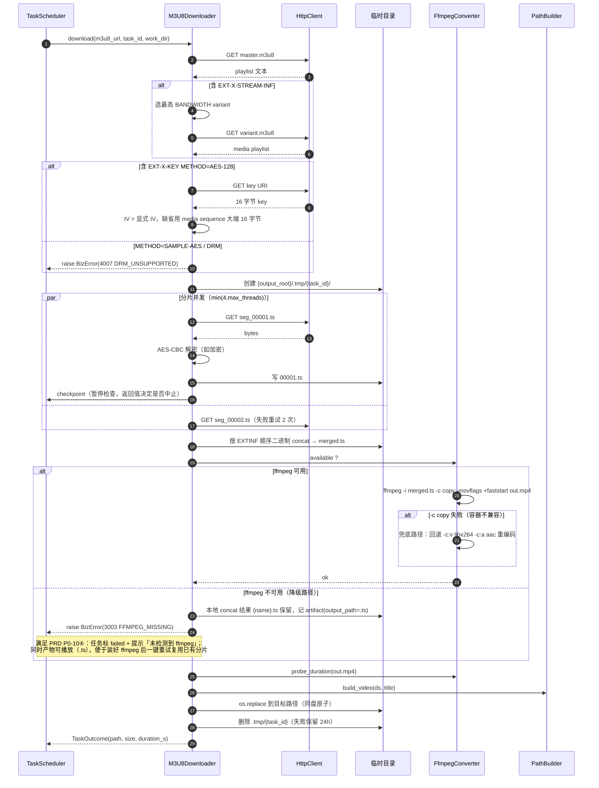
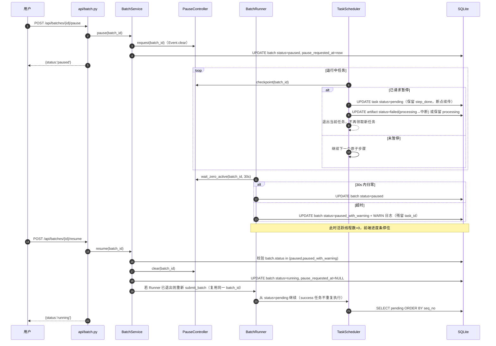

# CrawlerHub 通用爬虫平台 系统架构设计

| 项目 | 内容 |
| --- | --- |
| 文档版本 | v1.0 |
| 文档类型 | 系统架构设计 + 任务分解（实现级） |
| 上游输入 | `docs/PRD.md` v1.0（596 行，唯一需求来源） |
| 技术栈 | Python 3.11+ / FastAPI / SQLAlchemy 2.x(同步) / Pydantic v2 / SQLite(WAL) · Vue 3 + Vite + Element Plus + Pinia + ECharts |
| 部署形态 | 单机单进程 Web 应用；开发态双端口（5173 / 8000），生产态后端单端口 8000 静态托管前端产物 |
| 目标读者 | 后端工程师、前端工程师、测试工程师 |

---

## 1. 总体架构

### 1.1 分层与依赖方向



### 1.2 关键设计决策（在已拍板决策上细化）

| 编号 | 决策 | 理由 |
| --- | --- | --- |
| D-01 | 引擎为**进程内全局单例** `CrawlerEngine`，持有 `ThreadPoolExecutor` 池注册表；`BatchRunner` 每批次一个线程池 | 单机单用户，无需跨进程调度；批次独立池便于单批次暂停后自然收缩 |
| D-02 | 实际并发 = `min(batch.threads, global_capacity_remaining)`；`global_capacity_remaining = max_threads - 全局活跃任务数`，用 `threading.BoundedSemaphore` 守护 | 满足 PRD 9.3「批内并发受全局上限约束、不做数据源级配额」 |
| D-03 | 暂停用 `PauseController`（`threading.Event`）+ 任务内**原子步骤检查点**（每下载完一个分片/一章/一张图检查一次） | 不杀线程即可在 1 个原子步骤内回退，避免半成品文件 |
| D-04 | 数据库写操作全部走 `session_scope()` 短事务；引擎线程内不复用请求会话 | SQLite WAL 下单写多读，短事务避免 `database is locked` |
| D-05 | 任务失败原因统一 `error_code`（枚举字符串）+ `error_msg`（人话）+ `task_log.ERROR`（含 traceback）三层 | 满足 NFR-11「错误码 + 人话 + 查看日志」 |
| D-06 | JSON 字段统一以 TEXT 存储（SQLAlchemy `JSON` 类型，SQLite 落为 TEXT），读时通过 Pydantic 模型二次校验 | 保持可读 + 契约明确 |

---

## 2. 目录结构（完整文件清单，文件即任务边界）

```
crawlerhub/
  README.md
  .gitignore
  docs/
    PRD.md
    ARCHITECTURE.md
    architecture-diagram.mermaid
    class-diagram.mermaid
    sequence-diagram.mermaid
  backend/
    requirements.txt
    run.py
    app/
      __init__.py
      main.py
      config.py
      common/
        __init__.py
        errors.py
        logger.py
        timeutil.py
        filename.py
        path_builder.py
        disk.py
        fingerprint.py
      db/
        __init__.py
        base.py
        models.py
        migrate.py
        seed.py
      schemas/
        __init__.py
        common.py
        data_source.py
        batch.py
        task.py
        artifact.py
        setting.py
        dashboard.py
      api/
        __init__.py
        deps.py
        dashboard.py
        data_source.py
        batch.py
        task.py
        artifact.py
        setting.py
        system.py
      services/
        __init__.py
        data_source_service.py
        batch_service.py
        task_service.py
        artifact_service.py
        setting_service.py
        dashboard_service.py
        health_service.py
        system_service.py
      engine/
        __init__.py
        crawler_engine.py
        scheduler.py
        batch_runner.py
        strategy.py
        pause_control.py
        health_calculator.py
        script_sandbox.py
      parsers/
        __init__.py
        base.py
        html_list_parser.py
        m3u8_parser.py
        image_set_parser.py
        registry.py
      downloader/
        __init__.py
        http_client.py
        ffmpeg.py
        m3u8_downloader.py
        image_downloader.py
        text_writer.py
  frontend/
    package.json
    vite.config.ts
    tsconfig.json
    tsconfig.node.json
    env.d.ts
    index.html
    src/
      main.ts
      App.vue
      router/
        index.ts
      styles/
        index.scss
        variables.scss
      api/
        request.ts
        types.ts
        dashboard.ts
        dataSource.ts
        batch.ts
        task.ts
        artifact.ts
        setting.ts
        system.ts
      stores/
        app.ts
        dashboard.ts
        dataSource.ts
        batch.ts
        artifact.ts
        setting.ts
      utils/
        format.ts
        constants.ts
        download.ts
      layouts/
        MainLayout.vue
      components/
        common/
          PageHeader.vue
          EmptyState.vue
          StatusTag.vue
          HealthBadge.vue
          StatCard.vue
        charts/
          TrendChart.vue
          LoadGauge.vue
        source/
          SourceInfoBar.vue
          LastCursorCard.vue
          StrategyForm.vue
          StageProgress.vue
          TaskTable.vue
          TaskLogDrawer.vue
        datasource/
          SourceFormDrawer.vue
          ScriptEditor.vue
          ScriptTestDialog.vue
          ImportDialog.vue
          ExportDialog.vue
        artifact/
          ArtifactFilterBar.vue
        setting/
          PathTester.vue
          DangerZone.vue
      views/
        DashboardView.vue
        ContentListView.vue
        WorkbenchView.vue
        ArtifactView.vue
        DataSourceView.vue
        SettingView.vue
        VisualCreateView.vue
        NotFoundView.vue
```

> 说明 1：视频 / 文字 / 图片三套页面**共用** `ContentListView.vue` 与 `WorkbenchView.vue`，通过路由参数 `:type` 区分；差异仅在列定义、策略表单附加项与进度卡文案（映射表见 §11.6）。这是本设计中唯一的有意复用决策，可把 9 个页面压缩成 2 个。
>
> 说明 2：`docs/*.mermaid` 是 §1 / §5 / §6 三处图的**导出副本**（便于本地预览工具校验语法），**唯一权威源是 `ARCHITECTURE.md` 本身**；改图只改本文档再重新导出，不要反向修改。

---

## 3. 数据库设计

统一约定：`id INTEGER PRIMARY KEY AUTOINCREMENT`；全部时间字段为 `TEXT` 存 **ISO 8601 本地时区** `yyyy-MM-ddTHH:mm:ss.SSS+08:00`（毫秒精度，见 §11.3）；布尔用 `INTEGER 0/1`；JSON 用 `TEXT`。

### 3.1 `data_source` 数据源

| 字段 | 类型 | 约束/默认 | 说明 |
| --- | --- | --- | --- |
| id | INTEGER | PK AUTOINCREMENT | 主键 |
| name | TEXT | NOT NULL | 数据源名称，参与产物目录命名 |
| type | TEXT | NOT NULL, CHECK in ('video','text','image') | 内容类型 |
| category | TEXT | NULL | 分类；空则落盘用「未分类」 |
| homepage_url | TEXT | NOT NULL | 主地址 |
| alt_urls | TEXT(JSON) | DEFAULT '[]' | 备用地址字符串数组 |
| current_url | TEXT | NULL | 当前生效地址（工作页切换后持久化） |
| script | TEXT | NULL | Python 解析脚本全文，NULL=用内置解析器 |
| script_entry | TEXT | DEFAULT 'parse' | 脚本入口函数名 |
| config_json | TEXT(JSON) | DEFAULT '{}' | 内置解析器的 CSS 选择器与分页规则 |
| is_novel | INTEGER | DEFAULT 0 | 仅 text 生效，1=小说类 |
| enabled | INTEGER | DEFAULT 1 | 1 启用 / 0 停用 |
| health_score | INTEGER | NULL | 0-100，NULL=未知 |
| success_rate_20 | REAL | NULL | 近 20 次成功率快照 |
| last_success_at | TEXT | NULL | 最近成功时间（健康度衰减依据） |
| last_crawled_at | TEXT | NULL | 最近一次批次结束时间（列表页展示） |
| total_items | INTEGER | DEFAULT 0 | 累计成功条数（列表页展示，任务成功时 +1） |
| cursor_last_item_no | INTEGER | DEFAULT 0 | 游标：S1 上次最后条目序号 |
| cursor_last_page | INTEGER | DEFAULT 0 | 游标：S2 上次最后页码 |
| cursor_last_success_date | TEXT | NULL | 游标：S3 最近成功日期 `yyyy-MM-dd` |
| notes | TEXT | NULL | 备注 |
| is_deleted | INTEGER | DEFAULT 0 | 软删除；删除后历史批次/产物仍可查 |
| created_at / updated_at | TEXT | NOT NULL | 时间戳 |

索引：
- `uq_ds_name_url` **UNIQUE**(name, homepage_url) `WHERE is_deleted = 0`（SQLite 部分索引）→ 满足导入去重「同 name+homepage_url 跳过」，且软删除后允许重建同名源。
- `ix_ds_type_enabled`(type, enabled) → 三个列表页恒带 `type=? AND is_deleted=0 AND enabled=1`。
- `ix_ds_health`(health_score) → 首页健康度表按分数升序。

`config_json` schema（内置解析器）：
```json
{
  "list_url": "https://x.com/list?page={page}",
  "item_selector": ".list li",
  "link_selector": "a@href",
  "title_selector": "a@text",
  "date_selector": ".date@text",
  "detail_content_selector": "#content",
  "detail_image_selector": ".gallery img@src",
  "detail_video_selector": "video@src",
  "page_param": "page",
  "max_pages": 50
}
```

### 3.2 `crawl_batch` 爬取批次

| 字段 | 类型 | 约束/默认 | 说明 |
| --- | --- | --- | --- |
| id | INTEGER | PK | 主键 |
| data_source_id | INTEGER | NOT NULL, FK→data_source(id) | 所属数据源 |
| strategy | TEXT | NOT NULL, CHECK in ('count','page','date') | 策略类型 |
| strategy_params | TEXT(JSON) | NOT NULL | `{"n":50}` / `{"start":1,"pages":20}` / `{"from":"2026-10-01","to":"2026-10-25"}` |
| status | TEXT | DEFAULT 'pending' | pending/running/paused/success/success_with_warning/failed/paused_with_warning |
| phase | TEXT | DEFAULT 'parse' | parse（阶段一）/ execute（阶段二）/ done |
| total_tasks | INTEGER | DEFAULT 0 | 建任务后写入 |
| done_tasks | INTEGER | DEFAULT 0 | 成功数 |
| failed_tasks | INTEGER | DEFAULT 0 | 失败数 |
| skipped_tasks | INTEGER | DEFAULT 0 | 去重/页失败跳过数 |
| threads | INTEGER | NOT NULL | 本批次申请线程数（=发起时 max_threads 快照） |
| request_url | TEXT | NULL | 本批次实际使用的入口地址（含备用地址切换结果） |
| cursor_before | TEXT(JSON) | NULL | 批次开始时游标快照 |
| cursor_after | TEXT(JSON) | NULL | 批次结束时游标快照 |
| error_code / error_msg | TEXT | NULL | 批次级失败原因 |
| warnings | TEXT(JSON) | DEFAULT '[]' | 阶段一 WARN 汇总（截断到最后一页等） |
| pause_requested_at | TEXT | NULL | 暂停请求时间（30s 超时判定基准） |
| started_at / finished_at | TEXT | NULL | 时间 |
| created_at / updated_at | TEXT | NOT NULL | 时间戳 |

索引：
- `ix_batch_ds_status`(data_source_id, status) → **单飞约束查询**「是否存在 running/paused 批次」与数据源详情页；这是最高频查询。
- `ix_batch_status_created`(status, created_at DESC) → 首页「运行中批次」+ 批次列表按时间倒序。

### 3.3 `crawl_task` 爬取任务

| 字段 | 类型 | 约束/默认 | 说明 |
| --- | --- | --- | --- |
| id | INTEGER | PK | 主键 |
| batch_id | INTEGER | NOT NULL, FK→crawl_batch(id) | 所属批次 |
| data_source_id | INTEGER | NOT NULL | 冗余，供任务/产物跨批次筛选 |
| seq_no | INTEGER | NOT NULL | 列表内序号（1 起，游标推进依据） |
| title | TEXT | NOT NULL | 视频名 / 章节名 / 图集名 |
| source_url | TEXT | NOT NULL | 条目详情地址 |
| payload | TEXT(JSON) | DEFAULT '{}' | 阶段一解析出的附加字段（date、chapter_index、image_urls 等） |
| status | TEXT | DEFAULT 'pending' | pending/running/success/failed/paused/skipped |
| attempt_count | INTEGER | DEFAULT 0 | 已执行次数（手动重试不清零） |
| error_code / error_msg | TEXT | NULL | 失败原因 |
| step_total | INTEGER | DEFAULT 1 | 原子步骤总数（分片数/图片数/章节数=1） |
| step_done | INTEGER | DEFAULT 0 | 已完成原子步骤（前端进度条 + 断点续传依据） |
| duration_ms | INTEGER | DEFAULT 0 | 单次执行耗时 |
| started_at / finished_at | TEXT | NULL | 时间 |
| created_at / updated_at | TEXT | NOT NULL | 时间戳 |

索引：
- `ix_task_batch_status`(batch_id, status) → **调度器取任务**（`WHERE batch_id=? AND status='pending' ORDER BY seq_no LIMIT n`）与批次进度统计，核心热路径。
- `ix_task_ds_created`(data_source_id, created_at) → 数据源累计数、健康度近 20 次采样。
- `ix_task_status`(status) → 启动时孤儿 `running` 复位（NFR-05）。

### 3.4 `task_result` 任务结果

| 字段 | 类型 | 约束/默认 | 说明 |
| --- | --- | --- | --- |
| id | INTEGER | PK | 主键 |
| task_id | INTEGER | NOT NULL, FK→crawl_task(id) | 一对一（重试覆盖旧记录） |
| artifact_type | TEXT | NOT NULL | video/text/pdf/image |
| output_path | TEXT | NOT NULL | 落盘绝对路径（图片为目录） |
| file_size | INTEGER | DEFAULT 0 | 字节 |
| file_count | INTEGER | DEFAULT 1 | 图片数量 / 章节合并数 |
| fingerprint | TEXT | NULL | 内容指纹，S3 去重依据 |
| extra | TEXT(JSON) | DEFAULT '{}' | `{"duration_s":..,"word_count":..,"resolution":..}` |
| created_at | TEXT | NOT NULL | 时间戳 |

索引：`uq_result_task` UNIQUE(task_id)（重试 upsert）；`ix_result_fp`(fingerprint)（P2 去重预留）。

### 3.5 `task_log` 任务日志

| 字段 | 类型 | 约束/默认 | 说明 |
| --- | --- | --- | --- |
| id | INTEGER | PK | 主键 |
| batch_id | INTEGER | NOT NULL | 所属批次 |
| task_id | INTEGER | NULL | NULL=批次级日志 |
| level | TEXT | NOT NULL, CHECK in ('INFO','WARN','ERROR') | 级别 |
| message | TEXT | NOT NULL | 正文（ERROR 含 traceback 摘要 ≤ 4KB） |
| created_at | TEXT | NOT NULL | 毫秒时间戳 |

索引：`ix_log_batch_id`(batch_id, id) → 批次日志增量拉取（前端按 `last_id` 增量）；`ix_log_task_id`(task_id, id) → 任务日志抽屉；`ix_log_created`(created_at) → 清空 7 天前日志。

### 3.6 `artifact` 产物

| 字段 | 类型 | 约束/默认 | 说明 |
| --- | --- | --- | --- |
| id | INTEGER | PK | 主键 |
| task_id | INTEGER | NOT NULL | 溯源 |
| task_result_id | INTEGER | NULL | 溯源 |
| data_source_id | INTEGER | NOT NULL | 筛选维度 |
| data_source_name | TEXT | NOT NULL | 冗余，导出/展示免联表 |
| type | TEXT | NOT NULL | video/text/pdf/image |
| name | TEXT | NOT NULL | 展示名（去扩展名） |
| category | TEXT | NULL | 冗余分类 |
| path | TEXT | NOT NULL | 落盘路径 |
| size | INTEGER | DEFAULT 0 | 字节 |
| status | TEXT | DEFAULT 'processing' | processing/success/failed/missing |
| error_msg | TEXT | NULL | 失败原因（悬浮查看） |
| created_at / updated_at | TEXT | NOT NULL | created_at 为产物页日期筛选依据 |

索引：`ix_art_filter`(data_source_id, type, status, created_at DESC) → 产物页 5 条件组合（最左前缀命中数据源+类型）；`ix_art_created`(created_at DESC) → 无条件默认列表；`ix_art_name`(name) → 名称模糊（`LIKE 'x%'` 走索引，`%x%` 全扫但受 created_at 排序限制）；`ix_art_task`(task_id)。

### 3.7 `app_setting` 设置

| 字段 | 类型 | 约束/默认 | 说明 |
| --- | --- | --- | --- |
| key | TEXT | PK | 配置键 |
| value | TEXT | NOT NULL | 值（字符串；数值/布尔以字符串存，读取时转型） |
| updated_at | TEXT | NOT NULL | 更新时间 |

内置键（`db/seed.py` 首启写入）：
`profile.nickname`='采集者'、`profile.avatar`=''、`profile.email`=''、`output_root`=`<项目根>/output`、`max_threads`='4'、`retry.max_attempts`='3'、`retry.base_interval`='1'、`health.refresh_interval`='3600'。

另有 `schema_version` 单行表由 `db/migrate.py` 维护（`PRAGMA user_version` 亦可，本设计用 `app_setting` 的 `_schema_version` 键，避免额外表破坏「7 张表」约束）。

---

## 4. 后端 API 清单

统一响应体（见 §11.2）：`{"code":0,"data":...,"message":"ok"}`；分页 `data={"items":[],"total":0,"page":1,"pageSize":10}`。所有路径前缀 `/api`。

### 4.1 首页统计 `api/dashboard.py`

| Method | Path | 入参 | 出参 | 错误码 |
| --- | --- | --- | --- | --- |
| GET | `/api/dashboard/overview` | — | `{health:{healthy,total}, today, week, month, running:[BatchProgress]}` | 5000 |
| GET | `/api/dashboard/trend` | `granularity=day\|week\|month` | `{granularity, points:[{label,count}]}` | 1001,5000 |
| GET | `/api/dashboard/health` | `order=asc\|desc` | `[{data_source_id,name,type,health_score,success_rate_20,last_success_at}]` | 5000 |

> 首页四模块各自独立接口，任一失败仅该卡片显示 `--`（PRD 6.2 异常要求）；`overview` 内已内联运行中批次，故首页首屏只需 2 个请求。

### 4.2 数据源 `api/data_source.py`

| Method | Path | 入参 | 出参 | 错误码 |
| --- | --- | --- | --- | --- |
| GET | `/api/data-sources` | `type,keyword,category,enabled,page,pageSize` | 分页 `DataSourceItem[]`（含 health_score、alt_urls_count、last_crawled_at、total_items、has_script） | — |
| GET | `/api/data-sources/{id}` | — | `DataSourceDetail`（含 script、config_json、游标三字段） | 2001 |
| POST | `/api/data-sources` | `DataSourceCreate` | `{id}` | 1001,2002(重复) |
| PUT | `/api/data-sources/{id}` | `DataSourceUpdate` | `{id}` | 2001,2002 |
| PATCH | `/api/data-sources/{id}/enabled` | `{enabled:bool}` | `{enabled}` | 2001 |
| DELETE | `/api/data-sources/{id}` | — | `{deleted:1}` | 2001,2003(有运行中批次) |
| GET | `/api/data-sources/{id}/health` | — | `{health_score,success_rate_20,last_success_at,sample_size}` | 2001 |
| POST | `/api/data-sources/{id}/script/validate` | `{script,entry}` | `{valid,line,column,message}` | 2001 |
| POST | `/api/data-sources/{id}/script/test` | `{script,entry,url}` | `{count,fields:[],samples:[前5条]}` | 2001,4001(脚本异常),4002(超时) |
| POST | `/api/data-sources/import` | multipart `file`,`overwrite=bool` | `{success,failed,rows:[{line,status,reason}]}` | 1001,1002(格式错) |
| GET | `/api/data-sources/export` | `scope=all\|selected\|type`,`ids,type` | `application/json` 附件（UTF-8 数组） | — |
| GET | `/api/data-sources/template` | — | 导入模板 JSON 附件 | — |

### 4.3 批次 `api/batch.py`

| Method | Path | 入参 | 出参 | 错误码 |
| --- | --- | --- | --- | --- |
| POST | `/api/batches` | `{data_source_id,strategy,strategy_params,export_format?}` | `{batch_id,status:'pending'}` | 2001,3001(单飞冲突),3002(队列超 5000),3003(ffmpeg 缺失·视频),1001 |
| GET | `/api/batches` | `data_source_id,status,page,pageSize` | 分页 `BatchItem[]` | — |
| GET | `/api/batches/{id}` | — | `BatchDetail`（含 strategy_params、游标前后、warnings、counts） | 3004 |
| GET | `/api/batches/{id}/progress` | `after_log_id?` | `{batch:{status,phase,progress,total,done,failed,skipped,elapsed_ms},active:[{task_id,title,step_done,step_total}],logs?:[]}` | 3004 |
| POST | `/api/batches/{id}/pause` | — | `{status:'paused'}` | 3004,3005(状态非法) |
| POST | `/api/batches/{id}/resume` | — | `{status:'running'}` | 3004,3005 |
| POST | `/api/batches/{id}/retry-failed` | — | `{submitted:n}` | 3004,3006(无可重试) |
| GET | `/api/batches/{id}/logs` | `level,keyword,after_id,pageSize` | `{items:[{id,level,message,task_id,created_at}],last_id}` | 3004 |
| GET | `/api/batches/latest` | `data_source_id` | 最近一次批次摘要（工作页「上次采集到」） | 2001 |

### 4.4 任务 `api/task.py`

| Method | Path | 入参 | 出参 | 错误码 |
| --- | --- | --- | --- | --- |
| GET | `/api/tasks` | `batch_id,status,keyword,page,pageSize` | 分页 `TaskItem[]`（含 step_done/step_total、extra 字数/图片数） | — |
| GET | `/api/tasks/{id}` | — | `TaskDetail` + `result` | 4003 |
| GET | `/api/tasks/{id}/logs` | `level,keyword,pageSize` | 日志数组 | 4003 |
| POST | `/api/tasks/{id}/retry` | — | `{status:'pending',attempt_count}` | 4003,3007(非 failed) |
| POST | `/api/tasks/retry` | `{task_ids:[]}` | `{submitted:n}` | 3007 |

### 4.5 产物 `api/artifact.py`

| Method | Path | 入参 | 出参 | 错误码 |
| --- | --- | --- | --- | --- |
| GET | `/api/artifacts` | `data_source_id,type,name,date_from,date_to,status,page,pageSize` | 分页 `ArtifactItem[]`（含 size、path、status、is_file_exists） | — |
| GET | `/api/artifacts/{id}` | — | `ArtifactDetail`（含 error_msg、文件缺失判定） | 4004 |
| POST | `/api/artifacts/{id}/open-dir` | — | `{opened:true}`（本机桌面端唤起；服务端执行，失败降级返回 path） | 4004,5001 |
| POST | `/api/artifacts/{id}/redownload` | — | `{task_id,status:'pending'}` | 4004,3007 |
| DELETE | `/api/artifacts/{id}` | `delete_file=bool` | `{deleted:1}` | 4004 |

### 4.6 设置 `api/setting.py` / 系统 `api/system.py`

| Method | Path | 入参 | 出参 | 错误码 |
| --- | --- | --- | --- | --- |
| GET | `/api/settings` | — | `{profile:{nickname,avatar,email}, output_root, max_threads, retry:{max_attempts,base_interval}, health:{refresh_interval}}` | — |
| PUT | `/api/settings` | 同出参（部分字段可选） | 全量设置 | 1001,5002(目录不可写) |
| POST | `/api/settings/avatar` | multipart `file`(≤2MB png/jpg) | `{url}` | 1001,1003 |
| POST | `/api/settings/test-path` | `{path}` | `{writable,errno?,reason?}` | — |
| POST | `/api/settings/purge-logs` | `{keep_days:7}` | `{deleted:n}` | — |
| GET | `/api/system/info` | — | `{version,python,db_path,db_size,output_root,ffmpeg:{available,version,path},threads:{active,max}}` | — |
| GET | `/api/system/metrics` | — | `{cpu_percent,memory:{used,total,percent},threads:{active,max},uptime_s}` | — |
| GET | `/api/health` | — | `{status:'ok',version}` | — |

### 4.7 错误码段

| 段 | 含义 | 示例 |
| --- | --- | --- |
| 0 | 成功 | — |
| 1000-1099 | 入参/格式 | 1001 PARAM_INVALID、1002 FILE_FORMAT、1003 FILE_TOO_LARGE |
| 2000-2099 | 数据源 | 2001 DS_NOT_FOUND、2002 DS_DUPLICATE、2003 DS_BUSY |
| 3000-3099 | 批次/调度 | 3001 BATCH_SINGLE_FLIGHT、3002 QUEUE_FULL、3003 FFMPEG_MISSING、3004 BATCH_NOT_FOUND、3005 BATCH_STATE_INVALID、3006 NOTHING_TO_RETRY、3007 TASK_NOT_RETRYABLE、3008 PAGE_OUT_OF_RANGE |
| 4000-4099 | 解析/下载 | 4001 SCRIPT_ERROR、4002 SCRIPT_TIMEOUT、4003 TASK_NOT_FOUND、4004 ARTIFACT_NOT_FOUND、4005 HTTP_ERROR、4006 M3U8_PARSE、4007 DRM_UNSUPPORTED、4008 DISK_FULL |
| 5000-5099 | 系统 | 5000 INTERNAL、5001 OS_ACTION_FAILED、5002 PATH_NOT_WRITABLE |

---

## 5. 核心类图



---

## 6. 时序图

### 6.1 创建批次 → 阶段一解析列表 → 阶段二线程池执行 → 进度回写

```mermaid
sequenceDiagram
    autonumber
    participant U as 用户
    participant W as WorkbenchView
    participant API as api/batch.py
    participant BS as BatchService
    participant CE as CrawlerEngine
    participant BR as BatchRunner
    participant SR as StrategyResolver
    participant P as BaseParser
    participant TS as TaskScheduler
    participant DL as M3U8Downloader
    participant DB as SQLite

    U->>W: 选策略 + 填参数，点「开始爬取」
    W->>API: POST /api/batches
    API->>BS: create(payload)
    BS->>DB: 查 running/paused 批次（单飞）＋ 队列长度
    DB-->>BS: 无冲突
    BS->>DB: INSERT crawl_batch(status=pending, phase=parse, threads=N)
    BS->>CE: submit_batch(batch_id, threads)
    CE->>BR: 新建 BatchRunner 并提交到批次池
    BS-->>API: batch_id
    API-->>W: {code:0, data:{batch_id}}
    W->>API: 每 2s GET /api/batches/{id}/progress

    BR->>DB: 读 data_source（current_url / cursor / config_json）
    BR->>SR: resolve(ds, strategy, params)
    loop 按策略翻页
        SR->>P: parse_list(url, page)
        P-->>SR: [{title, url, seq_no, date}]
    end
    SR->>SR: 去重 + 游标过滤 + 边界判定
    SR-->>BR: StrategyResult(items, skipped, warnings, cursor_after)
    alt 阶段一异常/0 条
        BR->>DB: UPDATE batch(status=failed|success, phase=done) + ERROR 日志
    else 正常
        BR->>DB: INSERT crawl_task × n（pending）; batch.total_tasks=n, phase=execute, status=running
        loop 直到无 pending 或批次数被暂停
            TS->>DB: SELECT 1 条 pending（seq_no 升序，加锁跳过 running）
            TS->>DB: UPDATE task status=running, attempt_count+1
            TS->>DL: download(m3u8_url, task_id, work_dir)
            DL-->>TS: mp4_path（含原子步骤 checkpoint）
            TS->>DB: INSERT task_result + artifact(status=success)
            TS->>DB: UPDATE task status=success, step_done=step_total; batch.done_tasks+1
            Note over TS,DB: 失败：status=failed + error_code + ERROR 日志 + batch.failed_tasks+1
        end
        BR->>DB: UPDATE batch cursor_after / status=success|success_with_warning|failed / finished_at
    end
    API->>DB: progress 聚合查询
    API-->>W: {batch:{progress, done, failed, active}, active:[...]}
```

### 6.2 m3u8 下载转 MP4（ffmpeg 主路径 + 兜底路径）



### 6.3 暂停 → 任务回退 pending → 恢复



---

## 7. 三种策略计算与游标推进

### 7.1 数据准备（阶段一公共前置）

```text
def resolve(ds, strategy, params):
    base = ds.current_url or ds.homepage_url
    parser = build_parser(ds)                       # script 优先，否则内置解析器
    cursor = {"last_item_no": ds.cursor_last_item_no,
              "last_page": ds.cursor_last_page,
              "last_success_date": ds.cursor_last_success_date}
    result = StrategyResult(items=[], skipped=0, warnings=[], cursor_after=cursor)
    try:
        dispatch[strategy](...)
    except BizError as e:
        result.status = "failed"; result.error = e      # 阶段一失败 → 不推进游标
    return result
```

### 7.2 S1 按条数（`count`，参数 `n`）

```text
n = params.n                       # 1..9999
items, page, parsed_pages = [], 1, 0
while len(items) < n and page <= cfg.max_pages:      # 边界：自动翻页补足
    try:
        batch = parser.parse_list(base, page)         # 每页为一次原子请求
    except BizError as e:
        if page == 1: raise e                         # 首页失败 → 阶段一失败
        result.warnings.append(f"第{page}页请求失败：{e.code}"); break
    if not batch:                                     # 边界：列表为空/到底
        break
    for it in batch:
        if it.seq_no > cursor.last_item_no:           # 游标过滤（首次游标=0 → 全部通过）
            items.append(it)
        if len(items) >= n: break
    page += 1; parsed_pages += 1

items = dedup(items, key=fingerprint)[:n]
result.skipped = len(all_candidates) - len(items)
if len(items) == 0:                                   # 边界：无新内容
    result.status = "success"; result.empty = True
elif len(items) < n:                                  # 边界：不足 n 条
    result.status = "success_with_warning"
    result.warnings.append(f"请求 {n} 条，实际获取 {len(items)} 条（已到列表末尾）")
else:
    result.status = "success"
# 游标：前进到本次成功项的最大 seq_no（部分失败时只按成功项推进，见 7.5）
result.cursor_after = {"last_item_no": max_success_seq, "last_page": page - 1}
```

### 7.3 S2 按分页（`page`，参数 `start` / `pages`）

```text
start, pages = params.start, params.pages           # start>=1, 1<=pages<=500
total = parser.parse_pages(base)                    # 解析不出总页数 → total=None
if total is not None and start > total:
    raise BizError(3008 PAGE_OUT_OF_RANGE, f"起始页 {start} 超出总页数 {total}")
end = (start + pages - 1) if total is None else min(start + pages - 1, total)
for p in range(start, end + 1):
    try:
        batch = parser.parse_list(base, p)
    except BizError as e:
        result.warnings.append(f"第{p}页失败已跳过"); result.skipped += 1   # 页级 skipped
        log(ERROR, f"page={p} {e.code}"); continue
    if not batch:                                   # 边界：中间页为空 → 视为结束
        result.warnings.append(f"第{p}页无数据，采集提前结束"); break
    items += batch
if total is not None and end < start + pages - 1:    # 边界：页数越界截断
    result.status = "success_with_warning"
    result.warnings.append(f"请求 {pages} 页，实际获取 {end-start+1} 页（已到最后一页）")
elif result.skipped > 0:
    result.status = "success_with_warning"
else:
    result.status = "success"
result.cursor_after = {"last_page": end}             # 游标 = 实际成功的最大页码
```

### 7.4 S3 按日期（`date`，参数 `from` / `to`）

```text
if (to - from).days > 365: raise BizError(1001, "日期跨度不能超过 365 天")  # 表单层已拦，服务端二次校验
fingerprints = SELECT fingerprint FROM task_result JOIN crawl_task
               WHERE data_source_id=? AND crawl_task.status='success'       # 历史成功指纹集合
all_items = parse_all_pages(base)          # 直到空页或 max_pages
candidates = []
for it in all_items:
    d = it.date
    if d is None:
        result.warnings.append(f"条目「{it.title}」缺少日期字段，已按保留处理")  # PRD 7.2
        candidates.append(it)
    elif from <= d <= to:
        candidates.append(it)
for it in candidates:
    if fingerprint(it) in fingerprints:
        result.skipped += 1                # 命中历史成功 → 跳过，不建任务
    else:
        items.append(it)
if result.skipped: result.status = "success_with_warning"
# 游标：成功项中的最大日期（不取 to，避免未完成条目被永久跳过）
result.cursor_after = {"last_success_date": max_success_date}
```

### 7.5 游标推进时机（实现清单）

| 触发点 | 代码位置 | 是否推进 | 实现要点 |
| --- | --- | --- | --- |
| 阶段一抛 `BizError` | `BatchRunner._phase_parse` | 否 | `batch.cursor_after = cursor_before` |
| 阶段一 0 条 | 同上 | 仅 `last_page`（S2） | 状态 `success`，`total_tasks=0` |
| 批次全部成功 | `BatchRunner._finalize` | 是 | 用 `StrategyResult.cursor_after` |
| 批次部分失败 | `BatchRunner._finalize` | 是（仅成功项） | `last_item_no = max(seq_no of success)`；失败项留在 `failed` 供重试 |
| 暂停后恢复并完成 | 同上 | 是 | 与全成功同路径 |
| 批次 `failed`（阶段一或全地址不可用） | 同上 | 否 | 保留 `cursor_before` |

> 边界总表（PRD 7.2 全覆盖）：S1 首次游标=0 / n>总数 → `success_with_warning` / 列表空 → 0 任务 / 自动翻页补足；S2 起始页越界 → `failed(3008)` / 页数越界 → 截断+WARN / 中间页空 → 停止 / 页请求失败 → skipped 继续；S3 缺日期 → 保留+WARN / 指纹命中 → skipped / 跨度>365 → 拦截；任意策略去重后 0 条 → `success` + 「没有需要采集的新内容」；同源运行中 → 拒绝（单飞）。

---

## 8. 前端设计

### 8.1 路由表

| Path | name | 组件 | 说明 |
| --- | --- | --- | --- |
| `/` | dashboard | `DashboardView.vue` | 首页看板 |
| `/content/:type(video\|text\|image)` | content-list | `ContentListView.vue` | 三类列表页复用，`props.type` |
| `/content/:type/:id/workbench` | workbench | `WorkbenchView.vue` | 工作页，`:id`=数据源 id |
| `/artifacts` | artifacts | `ArtifactView.vue` | 产物页 |
| `/data-sources` | data-sources | `DataSourceView.vue` | 数据源管理 |
| `/data-sources/visual-create` | visual-create | `VisualCreateView.vue` | P2 占位页 |
| `/settings` | settings | `SettingView.vue` | 设置页 |
| `/:pathMatch(.*)*` | not-found | `NotFoundView.vue` | 404 |

导航顺序固定：首页 / 视频 / 文字 / 图片 / 产物 / 数据源 / 设置（`router/index.ts` 中 `meta.order` 控制）。

### 8.2 组件树

```text
App.vue
└─ MainLayout.vue                     # 左侧 200px 导航 + 面包屑 + 右上角线程占用「3/8」+ 全局错误条
   ├─ DashboardView.vue
   │  ├─ StatCard.vue × 4             # 健康源 X/Y、今日、本周、本月
   │  ├─ TrendChart.vue               # ECharts 折线+柱混合，tab 日/周/月
   │  ├─ LoadGauge.vue                # ECharts 环形（CPU/内存）+ 线程进度条
   │  ├─ el-table 运行中批次           # 行内暂停/恢复/查看日志
   │  └─ el-table 数据源健康度         # 健康度列用 HealthBadge.vue，可排序
   ├─ ContentListView.vue             # 搜索区 + el-table + 分页；列定义由 type 驱动
   │  └─ el-drawer「数据源详情」（页面内联，无独立组件）
   ├─ WorkbenchView.vue
   │  ├─ PageHeader.vue
   │  ├─ SourceInfoBar.vue            # 当前网址下拉切备用地址 → 顶部提示「已切换至」
   │  ├─ LastCursorCard.vue           # 上次采集到：第 N 条 / 第 M 页 / 时间；无历史文案
   │  ├─ StrategyForm.vue             # 3 卡片式单选 + 动态字段 + 校验
   │  ├─ StageProgress.vue            # 阶段一文案 → 阶段二进度条 + 成功/失败计数
   │  ├─ TaskTable.vue                # 序号/标题/状态/耗时/大小/重试次数/操作；type 附加列
   │  └─ TaskLogDrawer.vue            # 级别过滤 + 关键字 + 自动滚动
   ├─ ArtifactView.vue
   │  └─ ArtifactFilterBar.vue        # 5 条件 + 查询/重置
   ├─ DataSourceView.vue
   │  ├─ SourceFormDrawer.vue         # 新增/编辑（含 ScriptEditor.vue）
   │  ├─ ScriptTestDialog.vue         # 试运行回显前 5 条
   │  ├─ ImportDialog.vue             # 拖拽上传 + 结果表
   │  └─ ExportDialog.vue             # 全部/选中/按类型
   ├─ SettingView.vue
   │  ├─ PathTester.vue               # 输出根目录「测试可写」
   │  └─ DangerZone.vue               # 清空日志 / 重建统计，二次确认
   ├─ VisualCreateView.vue            # 「敬请期待」
   └─ NotFoundView.vue
```

### 8.3 Pinia store 划分

| store | state 核心 | 主要 action | 说明 |
| --- | --- | --- | --- |
| `app.ts` | `threads:{active,max}`、`backendOnline`、`autoRefresh` | `fetchMetrics()`、`setAutoRefresh()` | 全局轮询 3s；供 MainLayout 与首页共用 |
| `dashboard.ts` | `overview`、`trend`、`healthList`、`granularity` | `loadAll()`、`loadTrend(g)` | `loadAll` 并行 `Promise.allSettled`，单卡失败置 `null` |
| `dataSource.ts` | `list`、`total`、`query`、`current`、`healthMap` | `fetchList()`、`save()`、`toggle()`、`remove()`、`importFile()`、`exportFile()` | 列表查询防抖 300ms 在组件侧 |
| `batch.ts` | `current`、`progress`、`logs`、`pollTimer` | `create()`、`startPolling(id)`、`stopPolling()`、`pause()`、`resume()`、`retryFailed()` | 2s 轮询唯一入口；组件卸载必 `stopPolling` |
| `artifact.ts` | `list`、`total`、`filters` | `fetchList()`、`remove()`、`redownload()` | 分页与筛选状态同源 |
| `setting.ts` | `settings`、`systemInfo` | `load()`、`save()`、`testPath()` | 保存后刷新 `systemInfo` |

### 8.4 axios 封装与错误处理约定（`api/request.ts`）

```ts
// 1) baseURL = '/api'（dev 由 vite proxy 转发到 127.0.0.1:8000）
// 2) 响应拦截：code === 0 → 返回 data；否则 ElMessage.error(`[${code}] ${message}`) 并 reject BizError
// 3) 网络错误：ElMessage 一次「服务连接失败，请确认后端已启动」+ app.setOnline(false)，5s 后重试探活
// 4) 5xx：toast 含「查看详情」折叠面板（err.response.data.detail）
// 5) 文件下载（导出/模板）走 responseType:'blob'，从 content-disposition 取文件名
// 6) 所有请求 20s 超时；取消用 AbortController（轮询切换批次时）
```

### 8.5 进度轮询实现要点（`stores/batch.ts`）

- `startPolling(batchId)`：立即执行一次 `GET /progress`，随后 `setInterval(2000)`；同一时刻只允许一个 timer（新批次先 `clearInterval`）。
- 终态判定：`status ∈ {success, success_with_warning, failed}` → 停止轮询 + 触发 `ElNotification`；`paused` → 停止轮询（改为按钮手动刷新）。
- 日志增量：携带 `after_log_id`，仅追加新日志，避免全量重渲染；`TaskLogDrawer` 打开时把轮询切换为 1s 仅拉日志。
- 页面隐藏优化：`document.hidden === true` 时暂停 timer，`visibilitychange` 恢复并立即拉一次。
- 组件 `onUnmounted` + `beforeRouteLeave` 双保险 `stopPolling()`。

### 8.6 ECharts 图表清单

| 图表 | 组件 | 类型 | 数据源 |
| --- | --- | --- | --- |
| 采集量趋势 | `TrendChart.vue` | bar + line 双轴（柱=成功数，线=7 日移动均值） | `/dashboard/trend?granularity=` |
| CPU 占用 | `LoadGauge.vue` | gauge/环形 | `/system/metrics` |
| 内存占用 | `LoadGauge.vue` | gauge（mode=memory） | `/system/metrics` |
| 健康度分布（可选） | `DashboardView.vue` 内联 | 横向 bar（按分数升序） | `/dashboard/health` |

统一：`echarts` 按需 `echarts/core` + `BarChart/LineChart/GaugeChart` + `GridComponent/TooltipComponent/LegendComponent` 注册；`resize` 监听 `window`；深色/浅色只用一套浅色主题（本期）。

---

## 9. 任务列表（按实现顺序，共 18 条）

> 规则：同一模块的文件放在同一任务；路径与 §2 目录树一一对应；每个任务完成后项目应可运行（可增量验证）。

| 任务ID | 任务名 | 所属模块 | 涉及文件 | 依赖 | 验收点 |
| --- | --- | --- | --- | --- | --- |
| **T01** | 项目基座与公共基础 | 基座 | `README.md`、`.gitignore`、`backend/requirements.txt`、`backend/run.py`、`backend/app/__init__.py`、`backend/app/main.py`、`backend/app/config.py`、`backend/app/common/__init__.py`、`backend/app/common/errors.py`、`backend/app/common/logger.py`、`backend/app/common/timeutil.py` | — | ① `pip install -r` 后 `python -m backend.run` 起 8000；② `GET /api/health` 返回 `{code:0}`，`/docs` 可访问；③ `config.py` 全部配置来自环境变量/DB，无硬编码端口与路径；④ `BizError(code,msg)` + 错误码枚举可用；⑤ 日志同时输出控制台与 `logs/app.log`（滚动 5MB×3） |
| **T02** | 数据库层 | 数据 | `backend/app/db/__init__.py`、`backend/app/db/base.py`、`backend/app/db/models.py`、`backend/app/db/migrate.py`、`backend/app/db/seed.py`、`backend/app/schemas/__init__.py`、`backend/app/schemas/common.py` | T01 | ① 首启生成 `data/crawlerhub.db`，7 表 + §3 全部索引齐全；② `PRAGMA journal_mode=wal` 生效；③ `seed.py` 写入 8 个默认键 + `_schema_version=1`；④ `migrate.py` 幂等可重复执行；⑤ `schemas/common.py` 提供 `ok()/fail()/PageResp/Resp` 与 `CamelModel`（snake_case 出参） |
| **T03** | 公共工具与健康度 | 公共 | `backend/app/common/filename.py`、`backend/app/common/path_builder.py`、`backend/app/common/disk.py`、`backend/app/common/fingerprint.py`、`backend/app/engine/__init__.py`、`backend/app/engine/health_calculator.py`、`backend/app/services/__init__.py`、`backend/app/services/health_service.py` | T02 | ① `sanitize()` 覆盖 PRD 9.2 全部 7 条规则（含保留名、100 字符截断+哈希、空名兜底）；② `PathBuilder` 生成 4 种模板路径与 PRD 9.1 示例逐字符一致，分类空 → 「未分类」，图片序号 `001` 起；③ `disk.py` 剩余 <500MB 抛 `4008`；④ 健康度公式对 0 记录返回 `None`，≥80/60-79/<60 分级正确 |
| **T04** | 下载与转换层 | 下载 | `backend/app/downloader/__init__.py`、`backend/app/downloader/http_client.py`、`backend/app/downloader/ffmpeg.py`、`backend/app/downloader/m3u8_downloader.py`、`backend/app/downloader/image_downloader.py`、`backend/app/downloader/text_writer.py` | T03 | ① `HttpClient` 统一 UA/Referer/超时(15s)/连接复用，404/403→`4005` 且不重试；② `FfmpegConverter.detect()` 解析 `ffmpeg -version`，缺失时 `to_mp4` 抛 `3003`；③ AES-128 分片可解密（显式 IV 与缺省 IV 两种）；④ 分片并发 ≤ `min(4,max_threads)`，单分片失败重试 2 次；⑤ 双兜底：`-c copy` 失败自动转重编码；ffmpeg 缺失时仍完成分片下载 + 本地 concat 产出可播放 `.ts` 并保留，但任务按 PRD 标 `failed(3003)`；⑥ `TextWriter` txt 与 reportlab pdf（注册中文字体，缺字体回退 CID 字体不乱码）；⑦ `ImageDownloader` 单图失败不阻断并回调 `on_step` |
| **T05** | 解析层与脚本沙箱 | 解析 | `backend/app/parsers/__init__.py`、`backend/app/parsers/base.py`、`backend/app/parsers/html_list_parser.py`、`backend/app/parsers/m3u8_parser.py`、`backend/app/parsers/image_set_parser.py`、`backend/app/parsers/registry.py`、`backend/app/engine/script_sandbox.py` | T03、T04 | ① `ListItem` 数据类字段固定（title/url/seq_no/date/payload）；② 内置 3 解析器仅凭 `config_json` 选择器即可跑通样例站点；③ `M3U8Parser` 支持 master 取最高带宽、`EXT-X-KEY` 判定、`EXTINF` 时长；④ `ScriptSandbox.validate()` 返回行号列号，`execute()` 60s 超时抛 `4002`、异常抛 `4001` 且带 traceback；⑤ `registry.build_parser(ds)` 脚本优先、否则按 type 选内置 |
| **T06** | 设置与系统信息模块 | 设置 | `backend/app/schemas/setting.py`、`backend/app/services/setting_service.py`、`backend/app/services/system_service.py`、`backend/app/api/__init__.py`、`backend/app/api/setting.py`、`backend/app/api/system.py` | T02、T04 | ① `GET/PUT /api/settings` 全字段往返；② `max_threads` 1-32 越界返回 1001；③ `test-path` 返回 `{writable,errno,reason}`；④ 头像上传 ≤2MB 限 png/jpg；⑤ `/system/info` 含 ffmpeg 版本/路径、DB 路径与大小、线程占用；⑥ `/system/metrics` 单次 <100ms |
| **T07** | 数据源模块 | 数据源 | `backend/app/schemas/data_source.py`、`backend/app/services/data_source_service.py`、`backend/app/api/deps.py`、`backend/app/api/data_source.py` | T03、T06 | ① CRUD + 启停 + 分页搜索（关键字命中名称或地址）；② 唯一性 `name+homepage_url` 冲突 → `2002`；③ 导入 JSON/CSV 返回逐行结果，`overwrite=false` 跳过重复；④ 导出 UTF-8 JSON 且往返无损；⑤ 删除有 running 批次的数据源 → `2003`；⑥ 删除为软删（`is_deleted=1`），历史任务/产物仍可查；⑦ 脚本语法的 `/script/validate`、`/script/test` 打通 |
| **T08** | 策略计算与暂停控制 | 引擎 | `backend/app/engine/strategy.py`、`backend/app/engine/pause_control.py` | T05 | ① `StrategyResolver` 返回 `StrategyResult(items,skipped,warnings,cursor_after,status)`；② §7 全部边界（含 S2 越界 `3008`、S3 缺日期保留）有对应分支且返回预期状态；③ `PauseController.checkpoint()` 幂等、`wait_zero_active(30s)` 返回是否归零；④ 纯函数无 DB 依赖，可用假 parser 单测 |
| **T09** | 引擎与批次执行 | 引擎 | `backend/app/engine/crawler_engine.py`、`backend/app/engine/scheduler.py`、`backend/app/engine/batch_runner.py` | T04、T05、T07、T08 | ① `CrawlerEngine` 全局单例，`submit_batch` 幂等（同 batch_id 重复提交不重复起线程）；② 实际并发不超过 `max_threads`（8 慢任务+线程数 2 验证）；③ 单飞：同源 running 批次存在时拒绝；④ 两阶段：阶段一失败不建任务不推进游标；⑤ 暂停后运行任务在当前原子步骤回退 `pending`，30s 归零；⑥ 重试退避 1/2/4s 上限 30s；404/403/脚本错误不重试；⑦ 启动时孤儿 `running` 任务复位为 `pending`（NFR-05） |
| **T10** | 批次/任务/产物 API | 接口 | `backend/app/schemas/batch.py`、`backend/app/schemas/task.py`、`backend/app/schemas/artifact.py`、`backend/app/services/batch_service.py`、`backend/app/services/task_service.py`、`backend/app/services/artifact_service.py`、`backend/app/api/batch.py`、`backend/app/api/task.py`、`backend/app/api/artifact.py` | T09 | ① 建批次返回 `batch_id` 且立即 pending→running；② `/progress` 2s 轮询字段齐全（progress 四舍五入取整、active 任务 step 进度）；③ 暂停/恢复/重试全部失败接口幂等且有状态校验（`3005/3006/3007`）；④ 任务列表支持状态/关键字过滤与分页；⑤ 产物 5 条件组合 + 10/20/50 分页 + `is_file_exists` 判定；⑥ 打开目录失败降级返回 path |
| **T11** | 首页统计 API | 接口 | `backend/app/schemas/dashboard.py`、`backend/app/services/dashboard_service.py`、`backend/app/api/dashboard.py` | T10 | ① `/overview` 单请求聚合健康源数/日周月/运行中批次 <800ms（1 万任务）；② `/trend` 三粒度 X 轴为按小时/按天/按天；③ 数值与 `crawl_task.status='success'` 统计一致；④ `/health` 支持按分排序，无记录返回 `null` |
| **T12** | 前端基座 | 前端基座 | `frontend/package.json`、`frontend/vite.config.ts`、`frontend/tsconfig.json`、`frontend/tsconfig.node.json`、`frontend/env.d.ts`、`frontend/index.html`、`frontend/src/main.ts`、`frontend/src/App.vue`、`frontend/src/router/index.ts`、`frontend/src/styles/index.scss`、`frontend/src/styles/variables.scss`、`frontend/src/api/request.ts`、`frontend/src/api/types.ts` | T11 | ① `npm i && npm run dev` 起 5173，`/api` proxy→8000；② 8 条路由懒加载可达（含 404）；③ `request.ts` 统一解包与错误 toast，`types.ts` 覆盖全部 DTO；④ Element Plus 中文 locale；⑤ `npm run build` 成功且 `dist/` 可由后端托管 |
| **T13** | 前端 API 与 Store 层 | 前端数据 | `frontend/src/api/dashboard.ts`、`frontend/src/api/dataSource.ts`、`frontend/src/api/batch.ts`、`frontend/src/api/task.ts`、`frontend/src/api/artifact.ts`、`frontend/src/api/setting.ts`、`frontend/src/api/system.ts`、`frontend/src/stores/app.ts`、`frontend/src/stores/dashboard.ts`、`frontend/src/stores/dataSource.ts`、`frontend/src/stores/batch.ts`、`frontend/src/stores/artifact.ts`、`frontend/src/stores/setting.ts` | T12 | ① 每个后端接口一个函数，命名与 §4 一一对应；② store 均暴露 `loading` 与错误兜底；③ `batch.ts` 轮询含终态停止、`visibilitychange`、防重入；④ `app.ts` 3s 指标轮询可关闭 |
| **T14** | 通用组件与布局 | 前端通用 | `frontend/src/layouts/MainLayout.vue`、`frontend/src/components/common/PageHeader.vue`、`frontend/src/components/common/EmptyState.vue`、`frontend/src/components/common/StatusTag.vue`、`frontend/src/components/common/HealthBadge.vue`、`frontend/src/components/common/StatCard.vue`、`frontend/src/utils/format.ts`、`frontend/src/utils/constants.ts`、`frontend/src/utils/download.ts`、`frontend/src/views/NotFoundView.vue` | T13 | ① `constants.ts` 统一 6 任务 + 6 批次 + 4 产物状态映射（文案/颜色/图标），全站复用；② `HealthBadge` 四色分级（≥80 绿/60-79 黄/<60 红/未知灰）；③ `EmptyState` 三件套（插画+说明+主操作）；④ Layout 含 7 项导航、面包屑、右上角「活跃/最大」线程、全局后端不可达红条；⑤ `format.ts` 提供字节/耗时/时间/百分比格式化，无 `NaN`/`undefined` |
| **T15** | 首页看板 | 首页 | `frontend/src/views/DashboardView.vue`、`frontend/src/components/charts/TrendChart.vue`、`frontend/src/components/charts/LoadGauge.vue` | T14 | ① 4 指标卡可点击跳转；② 趋势 tab 切换后重新拉数且 X 轴粒度正确；③ 系统信息 3s 刷新、可暂停、关闭后无请求；④ 运行中批次表含进度条与行内暂停/恢复/日志；⑤ 健康度表按分排序；⑥ 单卡失败显示「--」+ 重试图标，不影响其他卡 |
| **T16** | 内容列表页与工作页 | 内容采集 | `frontend/src/views/ContentListView.vue`、`frontend/src/views/WorkbenchView.vue`、`frontend/src/components/source/SourceInfoBar.vue`、`frontend/src/components/source/LastCursorCard.vue`、`frontend/src/components/source/StrategyForm.vue`、`frontend/src/components/source/StageProgress.vue`、`frontend/src/components/source/TaskTable.vue`、`frontend/src/components/source/TaskLogDrawer.vue` | T15 | ① 一路由三类型复用，vide/text/image 列差异由 `type` 映射；② 列表页搜索 300ms 防抖、停用行置灰禁用；③ 工作页备用地址下拉切换后顶部提示并随批次生效；④ 三策略表单互斥、字段随选切换、校验不过禁用主按钮；⑤ 阶段一「解析列表中…→本次解析到 N 条」，阶段二实时进度；⑥ 任务表状态色一致，行内重试/日志；⑦ 日志级别过滤+关键字高亮+自动滚动 |
| **T17** | 产物页与数据源页 | 产物/数据源 | `frontend/src/views/ArtifactView.vue`、`frontend/src/views/DataSourceView.vue`、`frontend/src/components/artifact/ArtifactFilterBar.vue`、`frontend/src/components/datasource/SourceFormDrawer.vue`、`frontend/src/components/datasource/ScriptEditor.vue`、`frontend/src/components/datasource/ScriptTestDialog.vue`、`frontend/src/components/datasource/ImportDialog.vue`、`frontend/src/components/datasource/ExportDialog.vue` | T16 | ① 产物 5 条件组合筛选 + 分页 10/20/50 + 「共 N 条」；② 路径超长省略+悬浮全量、文件缺失标「文件缺失」并禁用打开目录；③ 数据源表格字段齐全，新增/编辑抽屉必填校验、URL 格式校验；④ 导入拖拽上传 + 结果表（成功/失败/原因）+ 覆盖同名开关；⑤ 导出支持全部/选中/按类型并下载 JSON；⑥ 脚本编辑器（等宽+行号）与试运行回显前 5 条 |
| **T18** | 设置页与端到端联调 | 设置/联调 | `frontend/src/views/SettingView.vue`、`frontend/src/views/VisualCreateView.vue`、`frontend/src/components/setting/PathTester.vue`、`frontend/src/components/setting/DangerZone.vue` | T17 | ① 设置四区块（个人信息/采集/系统信息/危险操作）保存生效，线程数越界即时报错；② 「测试可写」返回具体 errno 原因；③ ffmpeg 未安装时红字提示影响；④ 占位页「敬请期待」不影响其他功能；⑤ `npm run build` 后后端静态托管，单端口 8000 完整走通：建数据源 → 三类各发起 1 次采集 → 暂停/恢复/重试 → 产物检索 → 设置修改；⑥ Chrome/Edge 1280px 无横向滚动 |

**并行建议**：T03→T05 与 T04 可两人并行（T05 仅依赖 T04 的 `HttpClient` 接口，可先按接口签名编码）；T12~T14 前端基座可在 T07 完成后启动，不必等 T11。

---

## 10. 依赖包清单

### 10.1 `backend/requirements.txt`

```
fastapi==0.115.5
uvicorn[standard]==0.32.1
SQLAlchemy==2.0.36
pydantic==2.10.3
pydantic-settings==2.6.1
python-multipart==0.0.19
requests==2.32.3
beautifulsoup4==4.12.3
lxml==5.3.0
reportlab==4.2.5
psutil==6.1.0
```

> 不引入 Celery/Redis（单机单进程）、不引入 alembic（自研 12 行 `migrate.py` 足够，PRD NFR-15 只要求 `schema_version`）、不引入 tenacity（退避 5 行自研，便于按 PRD 精确控制 1s×2^(n-1) 上限 30s）。

### 10.2 `frontend/package.json` 依赖

```json
{
  "name": "crawlerhub-web",
  "private": true,
  "version": "1.0.0",
  "type": "module",
  "scripts": {
    "dev": "vite",
    "build": "vue-tsc --noEmit && vite build",
    "preview": "vite preview"
  },
  "dependencies": {
    "vue": "^3.5.13",
    "vue-router": "^4.5.0",
    "pinia": "^2.3.0",
    "element-plus": "^2.9.1",
    "@element-plus/icons-vue": "^2.3.1",
    "echarts": "^5.5.1",
    "axios": "^1.7.9"
  },
  "devDependencies": {
    "@vitejs/plugin-vue": "^5.2.1",
    "typescript": "^5.7.2",
    "vue-tsc": "^2.1.10",
    "vite": "^6.0.3",
    "sass": "^1.83.0"
  }
}
```

---

## 11. 共享知识 / 跨文件约定

### 11.1 命名规范

- 后端：模块 `snake_case`；类 `PascalCase`；API 路径 kebab-case 复数（`/api/data-sources`）；JSON 出入参统一 **snake_case**（不转驼峰，前后端 TS 类型同步用 snake_case 字段名）。
- 前端：组件 `PascalCase.vue`；store `useXxxStore`；API 函数 `verbNoun`（`fetchBatchProgress`、`createBatch`）；常量 `UPPER_SNAKE`。
- 数据库：表名单数（`crawl_task`）、字段 `snake_case`、索引 `ix_表缩写_字段`、唯一索引 `uq_`。

### 11.2 统一响应体

```json
{ "code": 0, "data": { }, "message": "ok" }
```
- `code=0` 恒表示成功，`data` 为业务负载；非 0 时 `data=null`，`message` 为中文人话（可直接 toast）。
- 分页负载固定 `{ "items": [], "total": 0, "page": 1, "pageSize": 10 }`。
- HTTP 状态码：成功 200；参数错 400；未找到 404；状态冲突 409；未预期 500。**业务码与 HTTP 码并存**，前端以 `code` 为准、`status` 仅用于网络层判断。
- 后端用 `app/schemas/common.py` 的 `ok(data)` / `fail(code,msg)` 统一构造，禁止手写字典。

### 11.3 时间格式

- 存库与传输：ISO 8601 本地时区 `2026-10-25T10:32:31.123+08:00`（毫秒 + 时区偏移），由 `common/timeutil.now_iso()` 唯一生成。
- 日期字段（`cursor_last_success_date`、筛选 `date_from`）：`yyyy-MM-dd`。
- 落盘目录日期：任务执行日（本地时区）`yyyy-MM-dd`，非条目发布日期（PRD 9.1 补充 4）。
- 前端展示：`format.ts` 统一 `YYYY-MM-DD HH:mm`，相对时间（「3 分钟前」）仅用于健康度最近成功时间。

### 11.4 日志格式

- 应用日志（文件）：`%(asctime)s | %(levelname)-5s | %(name)s | %(message)s`，`logs/app.log`，`RotatingFileHandler(5MB, 3)`。
- `task_log` 表：只写**用户可读**的业务日志，不写调试栈；`ERROR` 消息格式 `[错误码] 人话描述 | detail=...`，traceback 截断 4KB 附后。
- 批次级日志 `task_id=NULL`，任务级必须带 `task_id`。
- 关键节点必须落日志：地址切换（前→后）、翻页进度（S1「已翻至第 K 页」）、暂停残留任务、跳过去重条数、降级路径（ffmpeg 缺失）。

### 11.5 常量与枚举定义位置

| 内容 | 位置 | 说明 |
| --- | --- | --- |
| 后端枚举（type/status/strategy/level/artifact_type） | `backend/app/config.py` 内 `class E` 常量类 | 与 DB CHECK 约束保持同一份字面量 |
| 错误码 | `backend/app/common/errors.py` `class ErrCode` | 前后端共享字面量，前端 `utils/constants.ts` 复制一份并在注释标注同步源 |
| 默认值（max_threads=4、上限 32、max_attempts=3、base_interval=1、缺盘阈值 500MB、队列上限 5000、暂停超时 30s、脚本超时 60s、分片并发 4） | `backend/app/config.py` `DEFAULTS` | 全部可被 `app_setting` 覆盖（除结构性上限） |
| 前端状态映射表 | `frontend/src/utils/constants.ts` `TASK_STATUS_MAP` / `BATCH_STATUS_MAP` / `ARTIFACT_STATUS_MAP` / `CONTENT_TYPE_MAP` | 唯一色值/文案来源（NFR-10） |
| 目录模板 | `backend/app/common/path_builder.py` 顶部 `TEMPLATES` | 唯一定义处 |

### 11.6 类型枚举与前端文案映射（关键一份）

| 枚举值 | 中文 | 颜色（Element Plus tag type） |
| --- | --- | --- |
| task: pending | 等待中 | info |
| task: running | 下载中 | primary |
| task: success | 成功 | success |
| task: failed | 失败 | danger |
| task: paused | 已暂停 | warning |
| task: skipped | 已跳过 | info(plain) |
| batch: pending/running/paused | 等待中/进行中/已暂停 | info/primary/warning |
| batch: success/success_with_warning/failed/paused_with_warning | 成功/成功(有警告)/失败/暂停(有残留) | success/warning/danger/danger(plain) |
| artifact: processing/success/failed/missing | 处理中/成功/失败/文件缺失 | primary/success/danger/info |
| type: video/text/image | 视频/文字/图片 | 用于导航与列表标题 |

### 11.7 其他强制约定

- **事务边界**：只在 `services/` 层开事务（`with session_scope() as db:`）；引擎线程内每完成一个原子步骤独立提交一次（保证暂停/崩溃后 `step_done` 可用）。
- **SQLite 必开**：`journal_mode=WAL`、`synchronous=NORMAL`、`busy_timeout=5000`、`foreign_keys=ON`。
- **文件落盘原子性**：先写 `{target}.part`，完成后 `os.replace()`；图片目录同理，先写 `.tmp/{task_id}` 再一次 `shutil.move`。
- **禁止在 API 层做 IO**：所有 HTTP 抓取只能发生在 `downloader/` 与 `engine/`。
- **前端禁止硬编码文案**：状态文案取自 `constants.ts`；错误文案取自后端 `message`。
- **端口/路径**：`config.py` 读 `CRAWLERHUB_PORT`（默认 8000）、`CRAWLERHUB_DB`（默认 `data/crawlerhub.db`）、`CRAWLERHUB_OUTPUT`（默认 `<root>/output`）；默认仅监听 `127.0.0.1`（NFR-18）。

---

## 12. 待明确事项（含默认假设）

| 编号 | 事项 | 默认假设（未确认按此实现） |
| --- | --- | --- |
| A-01 | 「打开所在目录」在纯 Web 场景无法直接唤起文件管理器 | 后端用 `os.startfile`（Windows）/`open`（macOS）/`xdg-open`（Linux）尝试执行，失败则返回 `path` 由前端提示「路径已复制」 |
| A-02 | PRD 说「6 张核心表」，实际列出 7 张 | 以 **7 张**为准（含 `app_setting`），验收按 7 张 |
| A-03 | 数据源删除语义 | 采用**软删除**（`is_deleted=1`），列表与选择器过滤，历史批次/任务/产物仍可查询（满足 P0-21 验收③） |
| A-04 | 批次暂停后 Runner 线程是否销毁 | 若批次池在 30s 内归零则销毁线程池并把批次落库为 `paused`；恢复时**重建** Runner（复用 batch_id，不重建任务） |
| A-05 | 恢复后 `threads` 是否跟随最新 `max_threads` | 跟随：恢复时重读设置，`实际并发 = min(batch.threads, 最新 max_threads)` |
| A-06 | ffmpeg 缺失时视频任务是否直接失败 | 两处拦截：① **创建视频批次时**前置校验，返回 `3003` 让用户先装 ffmpeg（避免整批白跑）；② 若已进入执行（并发中途卸载），仍完成分片下载 + 本地 concat 产出可播放 `.ts` 并登记 artifact，但任务按 PRD P0-10④ 标 `failed(3003)`，`error_msg` 给安装指引；装好 ffmpeg 后对该任务重试可复用已有分片 |
| A-07 | PDF 中文字体来源 | 优先探测系统 `NotoSansSC`/`msyh.ttc`/`simhei.ttf`；全缺失时用 reportlab 内置 `STSong-Light` CID 字体，保证不乱码 |
| A-08 | CSV 导入列约定 | 与 JSON 字段同名表头；`alt_urls` 用竖线分隔的字符串；`enabled`/`is_novel` 用 `1/0` 或 `true/false` |
| A-09 | 首页「日/周/月采集量」的起算点 | 自然日/自然周（周一起）/自然月的 00:00 本地时间起算 |
| A-10 | `skipped` 是否计入批次 `total_tasks` | 不计入：`total_tasks` = 实际建任务数；跳过数单独进 `skipped_tasks`（前端显示「跳过 N 条」） |
| A-11 | 任务 `seq_no` 唯一性 | 不建唯一约束（重试复用同一条记录，不新增行）；去重在阶段一完成 |
| A-12 | P2-02 定时调度 | 本期不建表不实现；`crawl_batch` **不预留** `source` 字段（保持 7 表字段最小），P2 落地时由 `migrate.py` 增列 `source TEXT DEFAULT 'manual'`，不破坏既有数据 |

---

## 13. 实现偏差记录（后端 T01–T11，2026-10-25）

> 本章节由后端工程师在实现完成后追加，仅记录**与本文档正文不一致之处及其原因**，不改动正文结论。
> 全部偏差均为「最小改动修正」，不影响接口契约与表结构语义。

| 编号 | 位置 | 文档原文 | 实现 | 原因 |
| --- | --- | --- | --- | --- |
| DEV-01 | §3.2 `crawl_batch` | 字段清单无 `export_format` | 新增 `export_format TEXT`（由 `db/migrate.py` 幂等补列） | `POST /api/batches` 的 `export_format`（txt/pdf）必须随批次持久化，否则暂停恢复、失败重试会丢失用户的导出格式选择 |
| DEV-02 | §3.7 种子值 / §11.7 | `output_root` 默认 `<项目根>/output` | 默认 `data/output`（`<项目根>/data/output`） | 产物根目录与 SQLite、日志统一收敛到 `data/`，避免污染项目根；仍可被设置页/`CRAWLERHUB_OUTPUT` 覆盖 |
| DEV-03 | §1.2 D-02 | 全局并发用 `threading.BoundedSemaphore` | `GlobalLimiter`（`threading.Condition` 实现的计数信号量，含 `set_limit()`） | `BoundedSemaphore` 不支持运行期改容量，而 PRD 9.3 要求「改 `max_threads` 后新取任务立即生效」；acquire/release/上限语义与 `BoundedSemaphore` 等价 |
| DEV-04 | §9 T04 验收⑤ / PRD 9.5 | HttpClient 未规定内部重试 | `http.retries` 默认 0（不做传输层重试），自动重试统一由 `TaskScheduler` 承担；m3u8 分片仍单独重试 2 次 | 双层重试会让 `attempt_count` 与实际请求次数不一致；集中到任务级后「退避 1s×2^(n-1)」与「attempt_count 递增」可被日志精确观察，404/403/脚本错误不重试的规则也只有一个决策点 |
| DEV-05 | §4.6 API 清单 | 无「重建统计」接口 | 新增 `POST /api/settings/rebuild-stats` → `{updated:n}` | PRD 6.8 设置页「危险操作」含「重建统计缓存」，需要后端落点；`purge-logs` 语义不同，不能合并 |
| DEV-06 | §9 T09 验收⑦ / NFR-05 | 只要求复位孤儿 `running` 任务 | 额外把 `running` 批次置为 `paused_with_warning` 并写 WARN 日志 | 否则进程重启后遗留的 `running` 批次会永久占用 single-flight，用户再也无法对该数据源发起采集（且前端进度条永远停在旧值） |
| DEV-07 | §9.2 文件名规则 3 | 「截断至 92 字符 + `_` + 8 位哈希」 | 「截断至 91 字符 + `_` + 8 位哈希」= 100 字符 | 同一条规则要求「单段名称 ≤ 100 字符」，92+1+8=101 会超限，按硬约束收敛 |
| DEV-08 | §10.1 依赖清单 | 无加密库 | 增补 `pycryptodome==3.21.0` | m3u8 `AES-128` 解密优先用 pycryptodome；**缺失时自动回退内置纯 Python AES-128-CBC**（已用 NIST SP 800-38A 向量在 `scripts/selftest_offline.py` 中验证），保证不强依赖 |
| DEV-09 | §6.2 / PRD P0-12④ | 「选择 pdf 时同路径换成 .pdf」 | 文字任务**始终先写 TXT**，`export_format=pdf` 时再追加 PDF；PDF 失败仅 WARN，任务仍成功、产物类型回退 `text` | 落实实现要求「PDF 失败不能让整个任务失败——txt 先落盘成功即可」 |
| DEV-10 | §7.2 S1 (`seq_no` 来源) | 未定义跨页全局序号的推算方式 | 以首屏条目数作为每页条数推算：`seq_no = (page-1)*page_size + idx + 1`；支持 `seq_no_selector` 或脚本显式返回覆盖 | 列表页本身没有「全局行号」，但 S1 游标跨批次比较依赖 `seq_no` 稳定；用同一解析器实例内缓存的 `page_size` 可保证同一批次内一致 |
| DEV-11 | §6.3 暂停时序 | 未描述「恢复与旧执行体退出」的竞态 | `resume` 先 `wait_runner_exit()` 等旧执行体退出；`_handle_paused` 改用条件更新（`WHERE status='paused'`）；执行体退出回调按对象身份回收注册 | 否则「恢复」后旧执行体的暂停收尾会把 `running` 覆写回 `paused`，并出现同批次双执行体 |
| DEV-12 | §5 类图 | 未定义暂停信号的传递方式 | `common/errors.py` 新增 `PauseRequested`（非错误码的控制流异常） | 下载器/写入器在原子步骤边界抛出，调度器捕获后把任务回退 `pending`，比逐层返回布尔值更不易漏判 |
| DEV-13 | §3.6 `artifact.path` | `NOT NULL` | `NOT NULL DEFAULT ''`，任务开始时以空路径登记「处理中」，成功/失败时回填 | 满足 P1-05「任务进行中产物记录为处理中」，此时落盘路径尚不可知 |

---

## 14. 实现偏差记录（前端 T12–T18，2026-10-25）

> 与 §13 同规则：仅记录**与本文档正文不一致之处及原因**，均为最小改动，不影响接口契约。

| 编号 | 位置 | 文档原文 | 实现 | 原因 |
| --- | --- | --- | --- | --- |
| DEV-14 | §8.1 路由 | 未指定 history 模式 | 使用 `createWebHashHistory()`（URL 形如 `/#/artifacts`） | 后端以 `StaticFiles(html=True)` 单端口托管 `dist`，**未提供「未知路径 → index.html」的 SPA fallback**，`/artifacts` 直连返回 404。hash 模式下服务端路径恒为 `/`，刷新与深链在 8000 单端口可用。若后续要 history 模式，需后端补 404 回退（属 `main.py` 改动，前端不改后端） |
| DEV-15 | §10.2 devDependencies | 无 `@types/node` | 增补 `@types/node@^22.10.2` | `vite.config.ts` 用 `fileURLToPath(new URL(...))` 解析 `@` 别名，需要 Node 类型才能通过 `vue-tsc` |
| DEV-16 | §10.2 / T12-⑤ | 依赖清单未含分包策略细节 | `manualChunks` 将 `@element-plus/icons-vue` 单独成块 + element-plus / echarts / vendor 分离；图标按需注册 39 个（不整包注册） | 整包注册图标时 element-plus chunk 达 965KB（>800KB 阈值）；拆分图标后 EP 794KB、icons 37KB、echarts 509KB，全部 < 800KB 且无循环 chunk |
| DEV-17 | PRD 6.3.3 | 线程数为「只读展示全局值」 | 按 PRD 实现为只读 + 「去设置」链接（未做 1~max_threads 选择器） | 后端 `POST /api/batches` 的 `BatchCreate` **不接受 threads**，并发只由设置表 `max_threads` 决定；给可交互选择器会造成「改了不生效」的误导 |
| DEV-18 | §8.4-⑥ | 所有请求 20s 超时 | 15s（上传/下载类单独 60s） | 与 T04 的 HttpClient 15s 对齐，避免前后端超时语义不一致；轮询间隔 2s，15s 已足够 |
| DEV-19 | §8.2 组件树 | 未列任务批量重试入口 | `TaskTable` 增加多选 + 「重试选中」→ `POST /api/tasks/retry` | 该接口在 §4.4 中存在但原设计无 UI 入口；补齐后 api 层与契约 1:1 且无死代码 |
| DEV-20 | §8.2 | 任务日志抽屉仅日志 | 抽屉顶部增加任务详情（源地址 / 耗时 / 重试次数 / 产物路径），数据来自 `GET /api/tasks/{id}` | 同上：`/tasks/{id}` 契约需要落点，且失败排查必须能看到源地址与产物路径 |
| DEV-21 | T17-⑥ | 「脚本编辑器（等宽+行号）」 | 手写 `textarea + 行号 gutter`（未引入 CodeMirror/monaco） | 体积优先：CodeMirror 会额外引入 300KB+；需求只要求等宽+行号+Tab 缩进，手写即可 |
| DEV-22 | PRD P1-02 | 保存前做脚本语法检查 | 编辑态调用 `/script/validate` 阻断保存；**新建态**仅提示「保存后可试运行」 | 语法校验接口路径为 `/data-sources/{id}/script/validate`，新建时尚无 id，无法在保存前校验（后端接口设计所限） |
| DEV-23 | PRD 6.7 行操作 | 「查看已关联任务数」 | 改为表格「累计采集」列 + 行内「采集」跳工作页 | 后端无「按数据源统计任务数」接口；`total_items` 与产物页筛选可满足同等排查诉求 |
| DEV-24 | PRD P1-03 | 切换备用地址需写切换日志 | 前端 `PUT /data-sources/{id}` 持久化 `current_url` 并提示；**切换日志缺失** | 后端 `update` 未写 `task_log`；如需审计日志需后端在 data_source_service.update 内补一条 INFO 日志 |
| DEV-25 | T17-④ 导入 | 未规定上传方式 | `el-upload`（`auto-upload=false` + `on-change`）本地读取后统一提交 | `auto-upload=true` 会让 el-upload 自行发请求，无法复用 axios 拦截器与统一错误提示 |
| DEV-26 | T12-② | 「8 条路由懒加载可达」 | 8 条路由均 `() => import(...)`；404 作为 `MainLayout` 子路由（保留侧边栏） | 与 §8.2 组件树一致（`NotFoundView` 画在 `MainLayout` 内），避免 404 时整页跳空 |

---

## 15. 缺陷修复记录（第 1 轮 QA 回归，2026-10-25）

> 来源：`docs/TEST-REPORT.md` §4（QA 独立测试，246 用例 / 3 个 `xfail(strict)` 钉住的源码缺陷）。
> 修复范围仅 `backend/app/`，未改动接口契约；三个用例的 `xfail` 标记已移除，回归见测试报告第 2 轮。

| 编号 | 缺陷 | 根因 | 修复 | 回归用例 |
| --- | --- | --- | --- | --- |
| BUG-02 | 同一数据源可并发起多个活跃批次（single-flight 失效） | `batch_service.create` 是「先 SELECT 判占用、再 INSERT」，两步之间无原子性，并发时各自通过校验 | ① `crawl_batch` 增加**部分唯一索引** `uq_batch_active(data_source_id) WHERE status IN ('pending','running','paused','paused_with_warning')`；② `create()` 捕获 `IntegrityError` → `rollback` → `3001`；③ `retry_tasks` 复活历史批次前做同源活跃批次预检（并发冲突同样落 `3001`），避免唯一索引被「重试旧批次」撞穿 | `test_concurrency.py::TestSingleFlightRace::test_concurrent_create_same_source_only_one_succeeds` |
| BUG-03 | 任务重跑重复登记产物，残留永久「处理中」僵尸记录 | `_create_artifact` 每次 `run_task` 都无条件 `INSERT`；`artifact` 只有非唯一索引 `ix_art_task` | ① `artifact` 增加**唯一索引** `uq_artifact_task(task_id)`（与 `uq_result_task` 对齐）；② `_create_artifact` 改 **upsert**：按 `task_id` 命中则复用同一行并重置 `status=processing / path='' / size=0 / error_msg=NULL`，同时清理历史重复行；③ 启动孤儿复位时把「`processing` 但任务非 running」的产物统一置 `failed`（`error_msg=服务重启导致任务中断…`），清掉历史僵尸 | `test_pause_resume.py::TestPauseResume::test_pause_during_gallery_does_not_duplicate_artifact_rows` |
| BUG-01 | PDF 降级为 TXT 后 `artifact.type` 仍为 `pdf` | `_finish_success` 的 `UPDATE artifact` 未同步 `type` 字段 | `_finish_success` 的更新语句增加 `type=outcome.artifact_type`，保证 `artifact.type` / 落盘后缀 / `task_result.artifact_type` 三者一致（DEV-09 语义） | `test_text_pdf.py::TestPdfExportEndToEnd::test_pdf_failure_does_not_fail_task` |
| QA-01（健壮性） | `pause_control.register()` 仅在事件不存在时 `set()`，同一 batch_id 的历史事件若停在「已暂停」会被新执行体继承 | `register()` 的初始化逻辑 | 改为**无条件** `event.set()`；`_fail_batch` 补 `pause.release()`，批次失败终态也回收登记 | 全量回归（无对应用例，属防御性修复） |

**数据库迁移兼容**：两个唯一索引通过 `db/migrate.py::_EXTRA_INDEXES` 幂等补齐（`CREATE UNIQUE INDEX IF NOT EXISTS`）。若旧库已存在重复数据，迁移会**跳过该索引并输出 ERROR 日志**（列出前 5 组冲突键），不会阻断启动；人工清理后重启即可生效——新建库由 `create_all` 直接建索引，无此问题。
